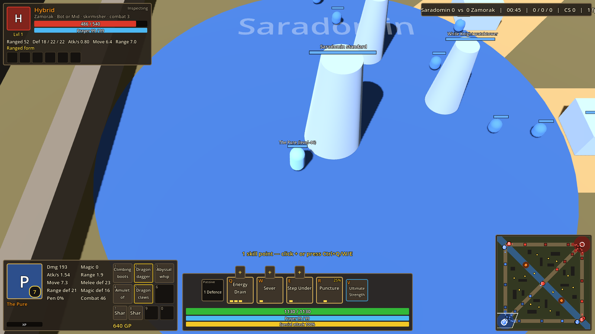
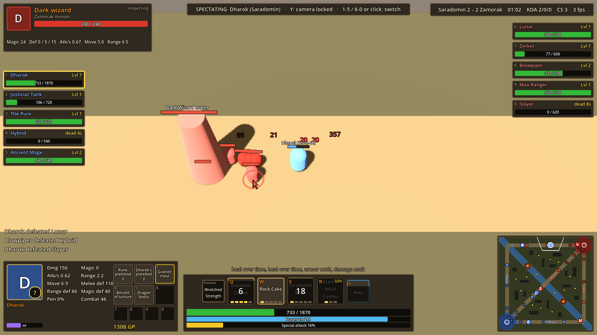

# Gielinor Legends

A free, fan-made 5v5 three-lane MOBA where every champion is an **Old School RuneScape gear build**: Full Dharok's, the 1 Defence Pure, Ahrim's + Ancients, the Range/Mage Hybrid, and more. Items are real OSRS gear with their real skill requirements, every ultimate is a special attack, and the map is a Saradomin-vs-Zamorak battlefield split by the Wilderness Ditch.

> **Fan project.** Gielinor Legends is 100% free and non-commercial, made to celebrate Jagex's work. Old School RuneScape and RuneScape are trademarks of Jagex Ltd. This project is not affiliated with or endorsed by Jagex, and it will never be sold or monetized.

Built with **Godot 4.7.2** (GDScript, Forward+).

## Status: whitebox prototype (v0.20)



Playable today, with primitive shapes standing in for art:

- **5v5**: play one champion with 4 bot allies, or **watch NPC vs NPC** in spectator mode.
- **League-style HUD**: portrait, stats, 6 item slots and food belt bottom-left; passive, Q/W/E/R with ranks and cooldowns, prayers and bars in the centre; minimap bottom-right; left-click any unit to inspect it top-left (with a ring under its feet).
- **League of Legends mob and structure stats**: minions, turrets, altars (inhibitors), the standard (nexus) and every jungle camp use Summoner's Rift numbers, wave timings and turret rules. See [docs/LOL_VALUES.md](docs/LOL_VALUES.md).
- **Champion select in the OSRS interface style** ([screenshot](docs/screenshots/champion_select.png)): portrait cards for every build; click one for its **Equipment Stats** view (gear slots, the figure slowly turning left and right, and its bonuses) and its abilities; **Skills** and **Prayer** tabs on the side; **LOCK IN** starts the game after a 5 second countdown. Nothing on the screen moves when you switch builds. With the private OSRS pack the portraits and figure are the real models; without it, a stand-in figure coloured from the build's gear.
- **All 24 OSRS skills for every build**: combat levels are fixed per build; every non-combat skill is **rolled 20–75 each game**, and one **lucky skill** per build (marked with a gold star) can roll all the way to 99 (the Skiller is always 99; the Slayer rolls 60–85 Slayer). Hover a skill (champion select, or your portrait in-game) to see which items that level unlocks.
- **Food and potions, OSRS-style**: anyone can buy and use any food or potion. Potions boost their own skill like in OSRS (a ranging potion gives Ranged +4 +10%, a super strength Strength +5 +15%; a Saradomin brew boosts Defence but lowers Attack, Strength, Ranged and Magic, and a super restore undoes that), and boosted levels raise that style's damage or your defence. With the Cooking (food) or Herblore (potions) level to make it, yours are **'perfect'** and 15% stronger (a 'perfect' shark heals 230 instead of 200); nothing under level 20 has a 'perfect' version. The shop shows the normal effect with the 'perfect' one underneath. The Dragon harpoon adds another 15%.
- **Skilling-gated items**: gear gated by Crafting, Smithing, Fletching, Slayer, Hunter, Thieving and Firemaking (leaf-bladed weapons hit monsters harder, chinchompas explode, the rogue outfit boosts last-hit gold, the bruma torch burns). Anything needing a skill above 75 is Skiller-only, unless a lucky roll gets there.
- **Skilling tools for fighters**: skill power from tools adds 20% of itself to anyone's basic attacks, axes and the dragon pickaxe hit towers harder, the Imcando hammer gives armour penetration, the Dragon harpoon boosts food, and the infernal axe and pyromancer garb burn.
- **Make your own gear**: with the level to make an item in OSRS (99 Smithing for a rune platebody, 80 for a godsword, 98 Crafting for an amulet of torture...) its combat requirements don't apply. That's how the Skiller (99 everything, 1 combat) wears combat gear, and a 1 Defence Pure with 63 Crafting can wear a green d'hide body.
- **Splash screen with updates**: shows the version; Check for updates finds the latest release, lists what's new and installs it (see [Updates](#updates-splash-screen)).
- **Home teleport animation**: recalling looks left, then right, then casts the OSRS teleport (arms out, the white-blue swirl and rune circle) and lands with the arrival animation. Eating and drinking animate too, and every level-up sets off fireworks.
- **League-style leveling**: start with nothing learned and one point; one point per level; basic abilities rank up to 5 (rank n at level 2n−1), R unlocks at 6/11/16.

- **The Wilderness Rift**: three lanes, the Ditch (visual only), four jungle quadrants, Jad and dragon pits, towers, altars and team flags with LoL-style destruction order, and a runtime-baked navmesh.
- **11 champions** with full data-driven kits (passive + Q/W/E/R), OSRS skill levels, and lane bots, including the **level-3 Skiller** ([in action](docs/screenshots/skiller_kit.png)), who never swings a weapon: Timber! plants up to three solid yews that block movement, then chops one so it falls away from where the Skiller stands ([fall-path indicator](docs/screenshots/timber_chop.png)); Bonfire, Harpoon and Anvil Drop do the rest, and every 4th ability sets off level-up fireworks.
- **League-style casting**: hold an ability key to see its indicator (range, line, cone, circle, dash), release to cast. Normal cast and quick cast are in Settings.
- **Tab scoreboard** ([screenshot](docs/screenshots/scoreboard.png)): every champion's level, K/D/A, CS, prayer (and whether it's on) and items (enemies' as your team last saw them).
- **The OSRS prayer book**: pick one of all 32 prayers at champion select (by Prayer level), switch it on with V, and watch it drain at real OSRS rates. Pray at the four **prayer altars** beside the red and blue buffs to refill. See [docs/PRAYER.md](docs/PRAYER.md).
- **The OSRS game tick** for auto attacks and food: swings land on 0.6s ticks (NPCs before champions), ranged hits a tick or more after the swing, and eating and drinking happen on the next tick. Movement, spells, cooldowns, status effects and prayers are real time, so you can dodge and cast the moment you click; flicking prayers every tick is still free. See [Game ticks](docs/ARCHITECTURE.md#game-ticks).
- **OSRS attack speeds**: every weapon swings at its OSRS speed in 0.6s ticks (whip 2.4s, Dharok's greataxe 4.2s, blowpipe 1.2s), with bigger hits to match.
- **OSRS hitsplats**: red for damage, blue for 0, a gold-trimmed max-hit splat for critical hits, green/teal/orange for poison/venom/burn; up to four per unit, and hits that aren't yours (not dealt by you or to you) are tinted darker.
- **Unit spacing**: champions, minions and monsters never stand inside each other; minions shuffle aside for champions, and nobody is pushed through a wall.
- **OSRS-sized numbers**: every health pool and damage/heal amount is scaled down (`rules.hp_scale`, 0.2) so hitsplats read like OSRS (a 25-minute bot match's biggest hit was 203). Killing blows take exactly the health left, and the bar empties.
- **Fog of war**: League sight ranges (champions and super minions 18 m, other minions 16 m, structures 18 m), shared by the whole team and blocked by walls. Enemies outside it vanish from the world and the minimap; the ground beyond your sight is darkened. Spectators press **F** to switch it off or on (for the watched champion's team); players can't.
- **Buffs and debuffs** show as icons with clock-wipe timers above the hotbar (and under the inspect panel for allies), with a short explanation on hover. Enemies' are never shown.
- **Grand Exchange** shop with Weapons, Armour, Boots, Consumables, Skilling and Materials tabs. Items build up League style from materials (cowhide, wool, logs, feathers, ore) and base items (leather boots, gold ring, coif, wizard robe...): parts you own anywhere down the recipe lower the price. It has an item grid with prices (red when you can't afford it, dimmed when your levels are too low) and a detail panel with a Buy button.
- **Tooltips** with solid backgrounds; ability tooltips show the damage they'd do right now: spell (by rank) + your stats + items = total ([screenshot](docs/screenshots/ability_tooltip.png)).
- **OSRS item and prayer icons**, and a two-letter tag on every champion's chest and back.
- **Ability tooltips** in colour: plain text white, your champion's stats light blue, scaling by style (melee red, magic blue, ranged green), items gold, cooldowns italic grey, plus what each rank adds. Every ability improves with rank (damage, durations, slows, ranges or amounts).
- **Attack and ability effects**: melee swipes (slash, overhead crush, thrust), weapon-matched projectiles (arrows, bolts, darts, thrown rocks, cannonballs, spell orbs and fireballs with trails), and per-ability effects (ice barrage shards, blood and shadow bursts, slams, multi-hit claw slashes, heal and buff glows, freezes, chinchompa explosions, arrow volleys).
- **Optional real OSRS models** from a private asset pack (personal builds only, never committed): fixed gear per champion, real OSRS animations, weapon swaps on item specs, TzTok-Jad and the Giant Mole. Without the pack the game uses its whitebox shapes. See [docs/OSRS_MODELS.md](docs/OSRS_MODELS.md).
- **Combat**: melee/ranged/magic triangle, three resists, OSRS tick attack speeds, special attack energy powering ultimates *and* spec-weapon items, overheads only on tank/main builds, one picked prayer per build. Champion ultimates built on a shop spec weapon are always better than the item or do something different ([why](docs/PRAYER.md#champion-abilities-vs-shop-spec-weapons)).
- **Shop**: 70+ OSRS items with real requirements (a 1 Defence Pure can't wear Bandos), build paths, spec actives (Dragon claws, AGS, Voidwaker...), and a food/potion belt.
- **Minion waves** (goblins, dark wizards, dwarf cannon carts), jungle camps with buffs, TzTok-Jad (telegraphs his next style), and the Giant Mole before 14:00.

## Running it

**Without Godot:** run a Windows build (`GielinorLegends.exe`, everything embedded). Windows SmartScreen may warn because the file isn't code-signed: choose *More info* > *Run anyway*.

**From source:**

1. Install [Godot 4.7.2](https://godotengine.org/download/) (standard build, not .NET).
2. Open this folder as a project and press **F5**.
3. Pick a build on the champion select screen.

Skip champion select from the command line:

```bash
godot --path . -- --champion=pure
```

### Controls

| Key | Action |
| --- | --- |
| Right-click | Move, or attack the unit under the cursor |
| Left-click | Select a unit to inspect it (top-left panel + ring under its feet) |
| Q W E R | Abilities (R is your special attack). Press to show the indicator, left-click to cast. You can bring the indicator up while already walking; a right-click cancels it and moves, and Esc cancels. Settings > Ability casting also offers quick cast with indicator (hold, release) and quick cast |
| Q (Skiller) | On open ground: plant a yew. On one of your yews: chop it; it falls away from you |
| Tab (hold) | Scoreboard |
| Ctrl + Q W E R / the + buttons | Spend a skill point |
| 1 – 6 | Item spec actives (Dragon claws, AGS, ...) |
| 7 8 9 0 | Food and potions |
| V | Your prayer on/off (picked at champion select; drains prayer points) |
| Z X C | Protect from Melee / Missiles / Magic (tank and main builds only) |
| Right-click a prayer altar | Walk there and pray: prayer back to full (beside each red and blue buff) |
| B | Teleport home |
| P | Grand Exchange (shop; buy at base) |
| S | Stop |
| Middle-mouse drag | Grab the map and pan freely |
| Minimap | Left-click/drag to look, right-click to walk |
| Space / Y | Centre camera / lock camera |
| Arrows, screen edge, wheel | Pan and zoom |
| Esc | Close the shop, or open the menu (Resume, Settings, Controls, Restart, Watch bots, Change champion, Quit) |

### Spectator mode (NPC vs NPC)

Pick **Watch NPC vs NPC** on champion select or in the Esc menu (or run `godot --path . -- --spectate`). All 10 champions are bots.



| Input | Action |
| --- | --- |
| Left-click a champion, its roster card, or press 1–5 / 6–0 | Lock onto it: the HUD shows its abilities, cooldowns, items and stats, the camera follows it, and the top-left panel shows its current target |
| Ghost cursor | Shows where the locked-on bot is clicking: green = move, red = attack, blue = ability (labelled Q/W/E/R or the item) |
| Y | Toggle the camera lock (pan freely with middle-mouse, edges or the minimap) |
| Left-click anything else | Inspect it |

Bindings are registered in `scripts/autoload/controls.gd` and can be overridden in Project Settings > Input Map.

## Tests

```bash
# Unit and kit tests (combat math, requirements, prayers, every ability of every champion)
godot --headless --path . res://tests/test_runner.tscn

# Self-play smoke test: 5v5 bots, waves, towers and camps for 4 game minutes
godot --headless --path . --fixed-fps 60 -- --smoke-test --smoke-seconds=240
```

CI runs both on every push (`.github/workflows/ci.yml`).

## OSRS models (private)

With the private model pack installed in `private_assets/osrs`, champions, monsters and effects use real OSRS models. Build the pack from the game cache with `tools/osrs_extract` (see [its README](tools/osrs_extract/README.md) and [docs/OSRS_MODELS.md](docs/OSRS_MODELS.md)); it can also export OSRS map squares for building the map. The pack is Jagex's material: never commit or publish it.

## Building the Windows .exe

With Godot 4.7.2 and its export templates installed (Editor > Manage Export Templates):

```bash
godot --headless --path . --export-release "Windows Desktop" build/windows/GielinorLegends.exe
```

The preset in `export_presets.cfg` embeds the game into the .exe, packs `data/*.json` and leaves out `tests/`. The `build/` folder is git-ignored.

## Updates (splash screen)

The game opens on a small splash screen with its version, **Play**, **Check for updates**, **Quit** and an **Update automatically** box (on by default). On opening, and whenever you click Check for updates, it reads the latest **GitHub release** of the repo in `data/rules.json` → `updates.repo` and compares its tag with `config/version` in `project.godot`. If the release is newer, it shows the release notes, downloads its `-windows.zip`, closes the game, unzips it over the game folder and starts the new version, all in one go. Play skips it. With the box off, the automatic check only offers **Update now**.

To publish an update:

1. Bump `config/version` in `project.godot` (and the file/product version in `export_presets.cfg`).
2. Add the version's section to `CHANGELOG.md`, commit and push to `main`. The Release workflow (`.github/workflows/release.yml`) sees the new version, tests the game, exports the normal Windows build and publishes the `vX.Y.Z` release with that changelog section as its notes. No tag is needed (pushing one, or running the workflow from the Actions tab, also works).

The game can only see public releases: GitHub hides a private repo's releases from anyone who isn't signed in. Never attach the private OSRS models to a release. The personal setup is the normal exe plus `osrs_models.pck` beside it (see [docs/OSRS_MODELS.md](docs/OSRS_MODELS.md)), so it updates like everyone else's: only the exe is replaced, and the models stay.

## Project layout

```
data/            All tunable game data (JSON) — champions, items, units, rules
scenes/          main.tscn (everything else is built in code for now)
scripts/
  autoload/      GameData (loads JSON), Controls (input map), Settings, GameTick (the 0.6s game tick), ModelPack (loads osrs_models.pck)
  core/          Combat math, DamageInfo
  units/         Unit base class, Champion, Minion, Structure, Monster, visuals
  abilities/     AbilityRunner: executes data-driven ability effects
  map/           MapLayout (coordinates), MapBuilder (geometry + navmesh)
  game/          Main (match flow), WaveSpawner, CameraRig, PlayerController
  ui/            Hud, ChampionSelect
tests/           Headless test runner
docs/            Design and developer docs
```

## Docs

- [CHANGELOG.md](CHANGELOG.md): what changed in each version (also the release notes the update button shows).
- [docs/DESIGN.md](docs/DESIGN.md): game design summary and key decisions
- [docs/ABILITIES.md](docs/ABILITIES.md): how to write champion kits and item specs in JSON
- [docs/ARCHITECTURE.md](docs/ARCHITECTURE.md): how the code fits together, and the roadmap
- [docs/LOL_VALUES.md](docs/LOL_VALUES.md): the League of Legends numbers used for minions, turrets and jungle, with sources
- [docs/OSRS_MODELS.md](docs/OSRS_MODELS.md): the private OSRS model pack: installing it, keeping it out of git, the personal build
- [docs/PRAYER.md](docs/PRAYER.md): the prayer book, OSRS drain rates, prayer altars, and how champion ultimates stay better than shop spec weapons

## Credits

- Old School RuneScape, its items, prayers and names belong to Jagex Ltd.
- Item and prayer icons come from [Dava96/osrs-icons](https://github.com/Dava96/osrs-icons) (icons from the OSRS Wiki, CC BY-NC-SA 3.0). Only the icons the game uses are included in `assets/icons`, listed in `assets/icons/SOURCE.json`. Because of that licence, the icons, like the whole project, stay free and non-commercial.

## Contributing

Most balance and content work is JSON-only: add a champion to `data/champions.json` or an item to `data/items.json`, then run the tests. Please verify item requirements against the [OSRS Wiki](https://oldschool.runescape.wiki/) and mark unverified ones with `"verify": true`.
